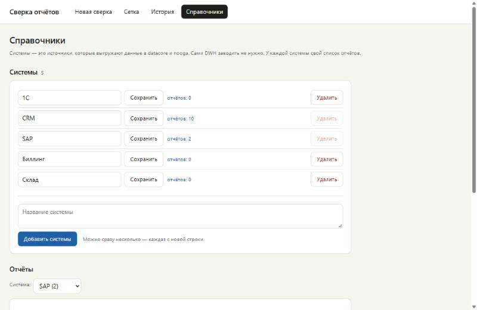
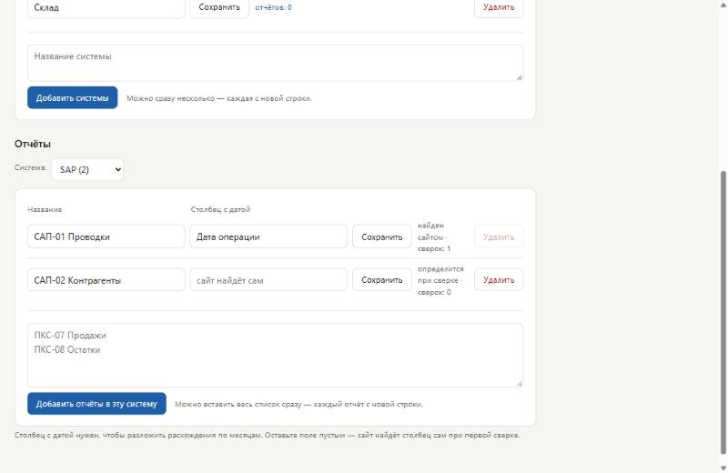
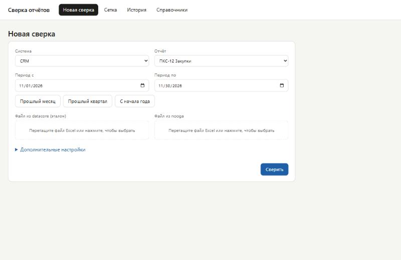
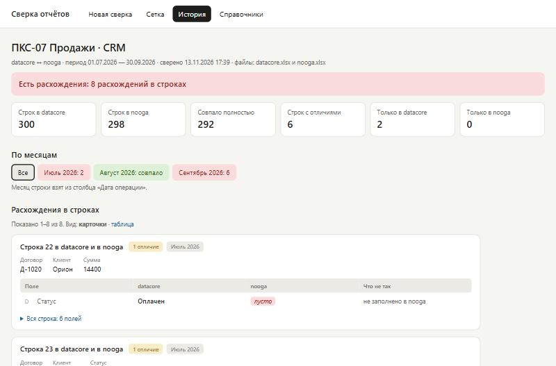
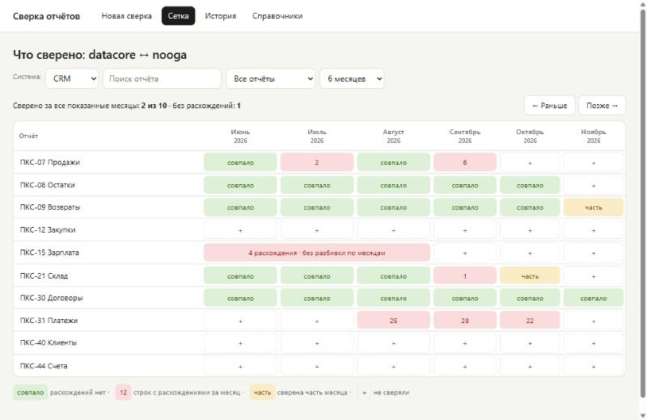
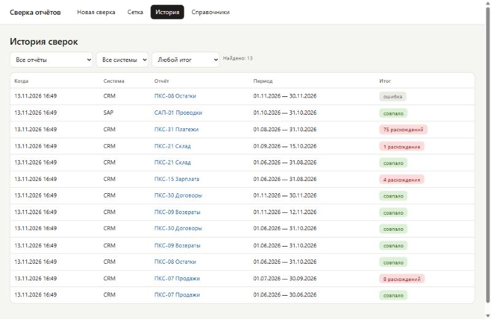

# Сверка отчётов

Сайт проверяет, что данные одного отчёта совпадают в двух хранилищах: **datacore** и **nooga**.

Вы загружаете два файла Excel. Сайт показывает, что не совпало, и запоминает результат.

Инструкция из трёх частей:

1. [Установка](#часть-1-установка) — делается один раз, около 20 минут.
2. [Запуск и остановка](#часть-2-запуск-и-остановка) — каждый день.
3. [Как пользоваться](#часть-3-как-пользоваться).

---

## Часть 1. Установка

### Шаг 1. Проверьте компьютер

Нужно три вещи:

- Windows 10 или Windows 11, 64-разрядная.
- Права администратора на этом компьютере.
- Включённая виртуализация.

Как проверить виртуализацию:

1. Нажмите `Ctrl + Shift + Esc`. Откроется «Диспетчер задач».
2. Откройте вкладку **Производительность**, слева выберите **ЦП**.
3. Справа внизу найдите строку **Виртуализация**. Там должно быть **Включено**.

Если написано «Отключено» — виртуализацию включают в BIOS. Обратитесь к администратору.

### Шаг 2. Установите Docker Desktop

Docker — программа, внутри которой работает сайт. Сам сайт ничего не ставит в Windows.

1. Откройте <https://www.docker.com/products/docker-desktop/>.
2. Нажмите **Download for Windows – AMD64**.
3. Запустите скачанный файл `Docker Desktop Installer.exe`.
4. Галочки в установщике не трогайте. Нажмите **OK**.
5. В конце нажмите **Close and restart**. Компьютер перезагрузится.
6. После перезагрузки запустите **Docker Desktop** из меню «Пуск».
7. Примите соглашение: **Accept**.
8. Вход в учётную запись пропустите: **Skip** или **Continue without signing in**.
9. Подождите. Внизу слева в окне Docker Desktop должна появиться зелёная надпись **Engine running**.

Готово, когда видите **Engine running**.

> Docker Desktop бесплатен для личного использования и небольших компаний.
> Крупным компаниям нужна платная подписка — уточните у своего администратора.

### Шаг 3. Установите Git

Git — программа, которая скачивает приложение с GitHub.

1. Нажмите `Win + X` и выберите **Терминал** (в Windows 10 — **Windows PowerShell**).
2. Вставьте команду и нажмите `Enter`:

   ```bash
   winget install Git.Git
   ```

3. Дождитесь слов **Successfully installed**.
4. Закройте окно терминала.

### Шаг 4. Скачайте и запустите приложение одной командой

1. Убедитесь, что Docker Desktop запущен и показывает **Engine running**.
2. Снова откройте терминал: `Win + X` → **Терминал**.
3. Вставьте команду и нажмите `Enter`:

   ```bash
   cmd /c "git clone https://github.com/aspacev/sverka.git && sverka\start.bat"
   ```

4. Откроется окно входа в GitHub. Войдите под учётной записью, которой дали доступ к репозиторию.
5. Подождите. Первый запуск идёт несколько минут: скачиваются нужные части.
6. Браузер сам откроет сайт по адресу <http://localhost:5000>.

Что сделала команда:

- скачала приложение в папку `sverka` внутри вашей папки пользователя (`C:\Users\ваше_имя\sverka`);
- собрала его в Docker;
- запустила сайт.

В папке `sverka` будут храниться и все ваши сверки. Не удаляйте её.

Установка закончена.

<details>
<summary>Вариант без Git: скачать архивом</summary>

1. Откройте <https://github.com/aspacev/sverka> и войдите в GitHub.
2. Нажмите зелёную кнопку **Code**, затем **Download ZIP**.
3. Распакуйте архив: правой кнопкой по файлу → **Извлечь все**.
4. Переместите распакованную папку в постоянное место, например `C:\sverka`.
5. Дважды щёлкните файл **start.bat** в этой папке.
6. Если Windows спросит, запускать ли файл, — нажмите **Подробнее** → **Выполнить в любом случае**.

</details>

---

## Часть 2. Запуск и остановка

Файлы для двойного щелчка лежат в папке приложения (`C:\Users\ваше_имя\sverka`).

| Что нужно | Что сделать | То же из терминала |
| --- | --- | --- |
| Открыть сайт | Запустите Docker Desktop, затем откройте <http://localhost:5000> | — |
| Сайт не открывается | Дважды щёлкните **start.bat** | `sverka\start.bat` |
| Остановить сайт | Дважды щёлкните **stop.bat** | `sverka\stop.bat` |
| Обновить до новой версии | Дважды щёлкните **update.bat** | `sverka\update.bat` |

После первого запуска сайт включается сам вместе с Docker Desktop.

Сверки не пропадают ни при остановке, ни при перезагрузке компьютера.

---

## Часть 3. Как пользоваться

Сначала один раз заполняются справочники (шаги 1 и 2). Потом вы только сверяете (шаги 3–5).

### Шаг 1. Добавьте системы

Система — это источник, который выгружает данные в оба хранилища.

1. Откройте **Справочники**.
2. В поле под списком впишите названия систем, каждое с новой строки.
3. Нажмите **Добавить системы**.



### Шаг 2. Добавьте отчёты

У каждой системы свой список отчётов.

1. На той же странице, в разделе **Отчёты**, выберите систему.
2. Вставьте список отчётов, каждый с новой строки.
3. Нажмите **Добавить отчёты в эту систему**.
4. Повторите для остальных систем.

Поле «Столбец с датой» можно не заполнять — сайт найдёт его сам.



### Шаг 3. Запустите сверку

1. Откройте **Новая сверка**.
2. Выберите **систему** и **отчёт**.
3. Укажите **период**: даты «с» и «по».
4. Перетащите файл из datacore в левое поле, файл из nooga — в правое.
5. Нажмите **Сверить**.



### Шаг 4. Посмотрите результат

Сверху — итог: совпало или есть расхождения.

Ниже:

- **По месяцам** — в каком месяце сколько расхождений. Нажмите на месяц, чтобы увидеть только его.
- **Расхождения в строках** — строки из двух хранилищ друг под другом. Отличия подсвечены.
- **Скачать Excel-отчёт** — тот же результат файлом.



### Шаг 5. Проверьте, что ещё не сверено

Откройте **Сетка** и выберите систему. Строки — отчёты, столбцы — месяцы.

| Клетка | Что значит |
| --- | --- |
| Зелёная «совпало» | Сверено, расхождений нет |
| Красная с числом | Столько строк с расхождениями за месяц |
| Жёлтая «часть» | Сверена только часть месяца |
| Пустая с «+» | Не сверяли. Нажмите, чтобы сверить |



### История

В разделе **История** лежат все сверки. Нажмите на строку, чтобы открыть результат.



---

## Если что-то не работает

| Что видите | Что сделать |
| --- | --- |
| Команда пишет, что `git` или `winget` не найдены | Закройте терминал и откройте заново. Если нет `winget` — скачайте Git с <https://git-scm.com/download/win> |
| Команда пишет, что папка `sverka` уже существует | Приложение уже скачано. Выполните `sverka\start.bat` |
| start.bat пишет «Docker не запущен» | Запустите Docker Desktop, дождитесь **Engine running**, запустите start.bat снова |
| Docker Desktop просит обновить WSL | Нажмите кнопку обновления в этом окне и перезапустите Docker Desktop |
| Сайт не открывается, хотя start.bat отработал | Подождите минуту и обновите страницу. Не помогло — запустите stop.bat, затем start.bat |
| Ошибка «port is already allocated» | Порт 5000 занят другой программой. См. «Настройки» ниже |
| Сверка закончилась ошибкой | Проверьте, что оба файла — Excel (.xlsx) и открываются. Причина написана на странице сверки |

---

## Дополнительно

<details>
<summary>Где хранятся данные и как сделать резервную копию</summary>

Всё лежит в папке `data` внутри папки приложения:

- `sverka.db` — сверки и справочники;
- `uploads` — загруженные файлы;
- `reports` — готовые Excel-отчёты.

Резервная копия — это копия папки `data`.

</details>

<details>
<summary>Как обновить приложение</summary>

Если устанавливали командой — дважды щёлкните **update.bat**. Он скачает новую версию и перезапустит сайт.
Сверки сохранятся.

Если скачивали архивом:

1. Запустите **stop.bat**.
2. Скачайте новый архив с GitHub.
3. Скопируйте файлы новой версии в папку приложения с заменой. Папку `data` не трогайте.
4. Запустите **start.bat**.

</details>

<details>
<summary>Настройки: порт и часовой пояс</summary>

Откройте файл `docker-compose.yml` в Блокноте.

- **Порт.** В строке `"127.0.0.1:5000:5000"` замените первое число 5000, например на 8080.
  Сайт откроется по адресу <http://localhost:8080>.
- **Часовой пояс.** Строка `TZ: Asia/Baku`. Для Москвы укажите `Europe/Moscow`.

После изменения запустите **start.bat**.

Сайт доступен только с того компьютера, где он запущен. Пароля на нём нет.

</details>

<details>
<summary>Для разработчиков</summary>

Запуск из терминала:

```bash
docker compose up -d --build
```

Запуск без Docker (Python 3.11 или новее):

```bash
pip install -r requirements.txt
```

```bash
python app.py
```

Тесты:

```bash
pip install -r requirements-dev.txt
```

```bash
python -m pytest -q
```

Сверка двух файлов из командной строки, без сайта:

```bash
python compare_excel.py файл1.xlsx файл2.xlsx
```

Названия хранилищ заданы в начале файла `app.py` (`DWH_A`, `DWH_B`).

</details>
